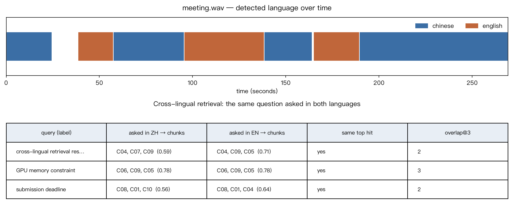

# Media analysis report — 多摩台媒体助手寂寞项目第三次碰头会议

Generated 2026-08-13 00:38 by the multimodal AI media assistant.

## 1. Recording and configuration

| Property | Value |
|---|---|
| Source file | meeting.wav |
| Duration | 00:00.0–04:30.6 (270.6 s) |
| Container / streams | wav, audio=True, video=False |
| Speech model | openai/whisper-large-v3-turbo |
| Language model | Qwen/Qwen3-4B-Instruct-2507 |
| Embedding model | Qwen/Qwen3-Embedding-0.6B |
| Device / dtype | mps · ASR float16 · LLM bfloat16 |
| Segments | 55 |
| Transcription time | 152.9 s (realtime factor 0.565) |

> **On confidence:** No per-segment confidence score is exposed. Where the decoder reports avg_logprob it is passed through unchanged as a mean token log probability; it is not calibrated and is never rescaled into a percentage.

## 2. Structured analysis (LLM, schema-validated)

**多摩台媒体助手寂寞项目第三次碰头会议**

会议讨论了转录管线、结构化分析与检索、工具Agent设计以及多语言课程的进展和计划。转录管线使用Whisper Large B3 Turbo在T4上运行，结果稳定，仅少量边界问题。结构化输出要求列表项必须真实，且解释文字最多出现两次，检索部分在跨语言查询中表现良好。Agent设计包含三个工具，运行步骤限制为5步，避免内存溢出。项目最终确定采用Ocean C多语言模式，不进行整列识别，原文与英文翻译需分开存储。提交截止日期为8月15日，演示视频定于8月13日完成，后续会议安排在8月8日。

### Key points

- 转录管线使用Whisper Large B3 Turbo在T4上运行，50秒内完成5分钟40秒录音的转录，仅3个边界分割位置不理想。
- 结构化输出要求列表项必须真实，解释性文字最多出现两次，当前版本已基本稳定。
- 检索测试显示12个跨语言查询中有10个在前3个结果中命中正确频段，结果可接受。
- Agent设计包含搜索转录、统计维度和获取媒体元数据三个工具，运行步数限制为5步，内存不足时需卸载模型并清空CUDA显存。
- 项目最终确定采用Ocean C多语言模式，保留中文人文转录并生成英文翻译，两者分开存储。
- 提交截止日期为8月15日，演示视频定于8月13日完成，会议决定在8月8日进行下一次碰头。

### Topics

- 转录管线进展
- 结构化分析与检索
- 工具Agent设计
- 多语言课程与提交时间

### Action items and decisions

| Item | Owner | Due |
|---|---|---|
| Freyya在8月9日前完成一人多工具演示 | Freyya | 2026-08-09 |
| 陈志远添加数字规范化处理，解决Whisper输出中文数字时阿拉伯数字或汉字混用的问题 | Chen Zhiyuan | — |
| DOM负责录制演示视频 | DOM | — |
| 记录人在此之前完成README初稿，明确实测的硬件和模型配置，不照搬推荐配置 | Wu Dongren | — |

### People and organisations mentioned

| Name | Type |
|---|---|
| 吴冬任 | person |
| 陈志远 | person |
| Ryanair | organisation |
| Freyya | person |
| DOM | person |
| Whisper | product |
| Ocean C | product |
| T4 | product |
| Collab | organisation |

### Languages observed

- Chinese
- English

### Suggested follow-up questions

- 如何具体定义和验证‘列表自断’中的‘真实列表’标准？
- 在跨语言检索中，哪些语言对的准确率表现最差？是否需要进一步优化？
- 数字规范化处理的具体实现方式是什么？是否会影响其他工具的性能？
- 为什么T4显存只有16GB，是否可以考虑使用其他硬件配置来支持更复杂的模型？
- 在最终数据结构中，原文与英文翻译字段如何设计才能避免混淆并便于后续使用？

### Validation

Accepted on attempt 1 of 3. Checked keys: `action_items`, `entities`, `follow_up_questions`, `key_points`, `languages`, `summary`, `title`, `topics`. Every list-valued field was confirmed to be a list before the analysis was accepted.

## 3. Transcript index

Segments are grouped into chunks of roughly 30 s, with 1 segment of overlap between neighbours. Chunks never span a change of language, so a bilingual passage is never averaged into one vector.

| Property | Value |
|---|---|
| chunk count | 11 |
| mean duration seconds | 25.04 |
| min duration seconds | 14.0 |
| max duration seconds | 37.0 |
| chunks per language | {"chinese": 7, "english": 4} |
| covered seconds | 269.14 |
| embedding model | Qwen/Qwen3-Embedding-0.6B |
| embedding dimension | 1024 |

## 4. Retrieval-augmented question answering

For every question the retrieved evidence is shown before the answer, so retrieval and generation can be judged separately. A question whose best match scores below 0.42 is refused without calling the language model; the model is also instructed to decline when the evidence it receives is not enough.

### Q1 — factual

**How many timestamped segments did Whisper produce on the test recording?**

_Stated directly in the English part of the recording._

Retrieved evidence:

| rank | chunk | timespan | language | score | text |
|---|---|---|---|---|---|
| 1 | C02 | 00:38.5–00:57.5 | english | 0.6609 | Let's start with part one, the transcription pipeline, Chen Zhiyuan got Whisper Large B3 Turbo running on Col… |
| 2 | C09 | 03:09.5–03:39.2 | chinese | 0.4922 | 還有兩個沒解決的問題第一,本地跑的時候沒有因為拿顯卡,只能換更小的模型ReadMe必须写清楚我们实测的硬件和模型不能照朝推荐配置第二Whisper输出中文数字的时候有时候是阿拉伯数字有时候是汉字这会影响CountMen… |
| 3 | C07 | 02:18.5–02:44.1 | chinese | 0.4521 | 第五部分我们选的是Ocean C,多语言模式,不做整列识别。我们的测试录音本身就是中音调替的,所以要保留人文转录,还单独生产一份英文翻译,两份都要存下来乱记了一个我觉得很好的点我要用同一段文字既做检索又做翻译展示容易混… |

**Answer** (answered: `True`)

> Whisper produced 47 timestamped segments on the test recording [C02 | 00:38.5–00:57.5].

Timestamp citations: `[C02 | 00:38.5–00:57.5]`

### Q2 — factual

**整段录音一共切出了多少个 chunk？**

_Stated directly in the Chinese part of the recording._

Retrieved evidence:

| rank | chunk | timespan | language | score | text |
|---|---|---|---|---|---|
| 1 | C04 | 01:21.5–01:35.5 | chinese | 0.6945 | 整段录音一共,切出19个chunk我们用其签问embedding 0.6b 测了12个跨语言查询有10个在头3里,令中了正确的频段这个结果我觉得可以接受 |
| 2 | C03 | 00:57.5–01:24.5 | chinese | 0.6717 | 第二部分和第三部分是我做的,结构和分析这块,我让模型一样的复习成。8个必须自断,都要较硬。列表自断必须是真的列表,第一版大概有五分之一的概率会在JSON外面做出一段解释文字,我加了从事,最多从事两次。现在基本稳定了检索… |
| 3 | C02 | 00:38.5–00:57.5 | english | 0.6272 | Let's start with part one, the transcription pipeline, Chen Zhiyuan got Whisper Large B3 Turbo running on Col… |

**Answer** (answered: `True`)

> 整段录音一共切出了19个chunk [C04 | 01:21.5–01:35.5].

Timestamp citations: `[C04 | 01:21.5–01:35.5]`

### Q3 — paraphrased

**agent 最多能跑几轮？**

_The recording says 'the loop is capped at five steps' in English. The question shares no wording with it and is in the other language._

Retrieved evidence:

| rank | chunk | timespan | language | score | text |
|---|---|---|---|---|---|
| 1 | C05 | 01:35.5–02:12.5 | english | 0.4641 | Now part for the agent, Ryanair is building a tool loop, we have three tools so far, search transcript, count… |
| 2 | C01 | 00:00.0–00:24.5 | chinese | 0.3782 | 大家好,今天是2026年8月11号,星期二,这是我们多摩台媒体助手寂寞项目的第三次碰头,我是吴冬任,负责这次的记录,今天要勾四件事,第一是转录管线的进展,第二是结构和分析和检索,第三是工具Agent的设计,第四是多语言… |
| 3 | C10 | 03:34.5–04:08.1 | chinese | 0.3288 | 这会影响CountMentions这个工具的统计陈志远说他加一层规议化最后规变今天的决定和行动想决定有三个第一,多模胎扩展确定的选Option C不做人脸第二,结构化输出加重式最多两次第三,原文转路和英文翻译分成两个字… |

**Answer** (answered: `True`)

> The agent loop is kept at 5 steps [C05 | 01:35.5–02:12.5].

Timestamp citations: `[C05 | 01:35.5–02:12.5]`

### Q4 — multi-chunk

**agent 的多工具演示能在提交截止日期之前做完吗？**

_Needs the 9 August action-item deadline (Chinese) and the 15 August submission deadline (English), which are in different chunks and different languages._

Retrieved evidence:

| rank | chunk | timespan | language | score | text |
|---|---|---|---|---|---|
| 1 | C08 | 02:44.9–03:09.5 | english | 0.5322 | About the schedule The submission deadline is August 15th and it will no move We also need to record the 3-0… |
| 2 | C05 | 01:35.5–02:12.5 | english | 0.4823 | Now part for the agent, Ryanair is building a tool loop, we have three tools so far, search transcript, count… |
| 3 | C01 | 00:00.0–00:24.5 | chinese | 0.4666 | 大家好,今天是2026年8月11号,星期二,这是我们多摩台媒体助手寂寞项目的第三次碰头,我是吴冬任,负责这次的记录,今天要勾四件事,第一是转录管线的进展,第二是结构和分析和检索,第三是工具Agent的设计,第四是多语言… |

**Answer** (answered: `True`)

> Yes, the agent's multi-tool demonstration can be completed before the submission deadline. The submission deadline is August 15th and it will no move [C08 | 02:44.9–03:09.5].

Timestamp citations: `[C08 | 02:44.9–03:09.5]`

### Q5 — unanswerable

**这个项目的预算是多少？**

_The recording never mentions money, cost or budget. The assistant must decline rather than guess._

Retrieved evidence:

| rank | chunk | timespan | language | score | text |
|---|---|---|---|---|---|
| 1 | C01 | 00:00.0–00:24.5 | chinese | 0.3014 | 大家好,今天是2026年8月11号,星期二,这是我们多摩台媒体助手寂寞项目的第三次碰头,我是吴冬任,负责这次的记录,今天要勾四件事,第一是转录管线的进展,第二是结构和分析和检索,第三是工具Agent的设计,第四是多语言… |
| 2 | C11 | 04:03.7–04:29.1 | chinese | 0.2933 | 行动向有四个Freyya在8月9号之前把一人的多工具演示做完陈志远加数字规一化DOM负责录demo视频我在这周围之前把readme的初稿写出来下次碰头是在8月8号星期二下午3点今天就到这里谢谢大家 |
| 3 | C05 | 01:35.5–02:12.5 | english | 0.2806 | Now part for the agent, Ryanair is building a tool loop, we have three tools so far, search transcript, count… |

**Answer** (answered: `False`, reason: `below_similarity_threshold`)

> I cannot answer that from this recording — the transcript does not contain relevant evidence (best match scored 0.30, below the 0.42 threshold).


## 5. Tool-using agent

**Task:** Find the passage where the agent's step limit is discussed, then count how many times the word 'agent' is said in the whole recording. Report both results with timestamps.

The loop is bounded at 5 steps by the application, not by the model. Tool names and every argument are validated before execution; a rejected call becomes an observation the model can recover from.

| step | tool | arguments | status | observation / error |
|---|---|---|---|---|
| 1 | search_transcript | {"query": "agent's step limit", "top_k": 3} | ok | [{"chunk_id": "C05", "timespan": "01:35.5–02:12.5", "score": 0.3917, "text": "Now part fo… |
| 2 | count_mentions | {"term": "agent"} | ok | {"term": "agent", "total_count": 2, "segments_containing_term": 2, "occurrences": [{"segm… |
| 3 | _(no tool)_ | — | ok | produced the final answer |

Tools used: `count_mentions`, `search_transcript` (2 successful of 2 calls). Stopped because: `final_answer`.

**Final answer**

> The agent's step limit is discussed in the passage from 01:35.5 to 02:12.5, where it is mentioned that the tool loop is kept at 5 steps. The word 'agent' is said twice in the recording: once at 00:00.0–00:24.5 and once at 01:35.5–02:03.5.

## 6. Multimodal extension — Option C, multilingual media mode

### 6.1 Language detection

2 languages detected across 6 switches.

| language | segments | seconds | share |
|---|---|---|---|
| chinese | 43 | 167.7 | 66.0% |
| english | 12 | 86.6 | 34.1% |

### 6.2 Language timeline

| timespan | language | seconds |
|---|---|---|
| 00:00.0–00:24.5 | chinese | 24.5 |
| 00:38.5–00:57.5 | english | 19.0 |
| 00:57.5–01:35.5 | chinese | 38.0 |
| 01:35.5–02:18.5 | english | 43.0 |
| 02:18.5–02:44.1 | chinese | 25.6 |
| 02:44.9–03:09.5 | english | 24.6 |
| 03:09.5–04:29.1 | chinese | 79.7 |

### 6.3 Cross-lingual retrieval

Each fact below is stated in only one language in the recording. Asking in the other language tests whether retrieval is semantic rather than lexical.

| question | evidence is in | asked in Chinese | asked in English | same top hit | overlap@k |
|---|---|---|---|---|---|
| cross-lingual retrieval result | `chinese` | C04, C07, C09 (0.590) | C04, C09, C05 (0.706) | yes | 2 |
| GPU memory constraint | `english` | C06, C09, C05 (0.783) | C06, C09, C05 (0.784) | yes | 3 |
| submission deadline | `english` | C08, C01, C10 (0.556) | C08, C01, C04 (0.640) | yes | 2 |

### 6.4 Two translation routes compared

The original transcript is preserved unchanged; translations are held in separate fields. Route A is Whisper decoding the audio directly into English; route B is the LLM translating the transcript text. The overlap column is a blunt word-overlap ratio, useful only for spotting rows worth reading.

| timespan | original | Whisper translate | LLM translate | overlap |
|---|---|---|---|---|
| 00:00.0–00:24.5 | 大家好,今天是2026年8月11号,星期二,这是我们多摩台媒体助手寂寞项目的第三次碰头,我是吴冬任,负责这次的记录,今天要勾四件事,第一是… | Hello everyone, today is August 11th, 2026, Monday. This is the third… | Hello everyone, today is August 11, 2026, Tuesday. This is the third… | 0.25 |
| 00:57.5–01:04.5 | 第二部分和第三部分是我做的,结构和分析这块,我让模型一样的复习成。 | The second and third parts are done by me. The structural analysis is… | The second and third parts are mine, regarding the structure and anal… | 0.25 |
| 01:04.5–01:07.5 | 8个必须自断,都要较硬。 | 8 must-haves must be called in. | 8 things that must be severed, all should be firm. | 0.25 |
| 01:07.5–01:16.5 | 列表自断必须是真的列表,第一版大概有五分之一的概率会在JSON外面做出一段解释文字,我加了从事,最多从事两次。 | The list of words must be a real list. The first version is about one… | The list must be a true list. The first version had about a fifth cha… | 0.28 |
| 01:16.5–01:18.5 | 现在基本稳定了 | Now it's basically stable | It is now basically stabilized. | 0.29 |
| 01:18.5–01:21.5 | 检索这边,我按30秒左右一块来接 | To unlock this side, I press the button for about 30 seconds | Search here, I'll pick them up in blocks of about 30 seconds. | 0.09 |
| 01:21.5–01:24.5 | 整段录音一共,切出19个chunk | I recorded a total of 19 chunks | The entire recording, cut into 19 chunks | 0.17 |
| 01:24.5–01:29.5 | 我们用其签问embedding 0.6b 测了12个跨语言查询 | We use QQ to ask the 12 languages ​​in the Embedding 0.6B car. | We used its sign question embedding 0.6b to test 12 cross-lingual que… | 0.26 |

### 6.5 Visual output



## 7. Reliability checks

| check | condition | result | detail |
|---|---|---|---|
| transcript: timestamps ordered | every segment satisfies start <= end | pass | 55 segments checked |
| transcript: text present | every segment has non-empty text | pass | 55 segments checked |
| transcript: ids unique | no segment id appears twice | pass | 55 distinct ids |
| transcript: monotonic | segments are ordered by start time | pass | checked pairwise |
| transcript: language labels match the script | no segment is labelled as a language its writing system contradicts | pass | 55 segments checked, 0 disagreements |
| index: one embedding per chunk | embeddings.shape[0] == len(chunks) | pass | 11 vectors for 11 chunks |
| index: embeddings normalised | every vector has unit length, so a dot product is a cosine | pass | norm range 1.0000–1.0000 |
| index: chunk ids unique | no chunk id appears twice | pass | 11 chunks |
| index: chunks are single-language | no chunk mixes two languages | pass | languages: ['chinese', 'english'] |
| media: missing file | a path that does not exist raises FileNotFoundError | pass | FileNotFoundError: Media file not found: definitely_not_a_real_file.wav |
| media: not a media file | a text file renamed .wav raises MediaError | pass | MediaError: Could not decode not_really_audio.wav: ffmpeg reported 'Invalid data found when processing input'. The file may be corrupt or may not be a media fi… |
| media: empty file | a zero-byte file raises MediaError | pass | MediaError: Media file is empty (0 bytes): .cache_media/empty.wav |
| tools: unknown tool | calling a tool that does not exist raises ToolError | pass | ToolError: unknown tool 'translate_to_french'; available tools are count_mentions, get_media_metadata, get_transcript_range, search_transcript |
| tools: missing argument | omitting a required argument raises ToolError | pass | ToolError: 'count_mentions' requires 'term' (the word or phrase to count) |
| tools: wrong argument type | a string where a number belongs raises ToolError | pass | ToolError: 'top_k' must be a number, got 'three' (str) |
| tools: unexpected argument | an argument the tool does not declare raises ToolError | pass | ToolError: 'search_transcript' does not accept limit; valid parameters are query, top_k |
| tools: out-of-range argument | a negative timestamp raises ToolError | pass | ToolError: 'start' must be at least 0, got -10.0 |
| tools: still usable after errors | a valid call succeeds after five rejected ones | pass | segment_count=55 |
| rag: normal question answered | a well-supported question is answered from the recording | pass | top score 0.661 |
| rag: answer carries timestamp citations | the answer cites timespans that appear in the retrieved evidence | pass | 1 of 1 citations matched retrieved chunks |
| rag: unanswerable question refused | a question with no supporting evidence is declined, not guessed | pass | top score 0.301 vs threshold 0.42; reason below_similarity_threshold |
| agent: impossible task handled | an unavailable tool ends in an answer, not an exception | pass | stopped_because=final_answer, tool_calls=0 |
| agent: step limit enforced | the loop never exceeds the step limit the application set | pass | 1 steps taken, limit 3 |

23 of 23 checks passed.

## Appendix — full timestamped transcript

```text
[00:00.0 → 00:24.5] 大家好,今天是2026年8月11号,星期二,这是我们多摩台媒体助手寂寞项目的第三次碰头,我是吴冬任,负责这次的记录,今天要勾四件事,第一是转录管线的进展,第二是结构和分析和检索,第三是工具Agent的设计,第四是多语言课程和提交时间。
[00:38.5 → 00:47.5] Let's start with part one, the transcription pipeline, Chen Zhiyuan got Whisper Large B3 Turbo running on Collab last Thursday on our 5-minute 40-second test recording.It produced 47 timestamped segments, and the whole transcription took about 50 seconds on a T4.
[00:47.5 → 00:57.5] We check the segment boundaries by hand, and only 3 of them we split at an awkward place, which is good enough for the chunking we want to do later.
[00:57.5 → 01:04.5] 第二部分和第三部分是我做的,结构和分析这块,我让模型一样的复习成。
[01:04.5 → 01:07.5] 8个必须自断,都要较硬。
[01:07.5 → 01:16.5] 列表自断必须是真的列表,第一版大概有五分之一的概率会在JSON外面做出一段解释文字,我加了从事,最多从事两次。
[01:16.5 → 01:18.5] 现在基本稳定了
[01:18.5 → 01:21.5] 检索这边,我按30秒左右一块来接
[01:21.5 → 01:24.5] 整段录音一共,切出19个chunk
[01:24.5 → 01:29.5] 我们用其签问embedding 0.6b 测了12个跨语言查询
[01:29.5 → 01:33.5] 有10个在头3里,令中了正确的频段
[01:33.5 → 01:35.5] 这个结果我觉得可以接受
[01:35.5 → 02:03.5] Now part for the agent, Ryanair is building a tool loop, we have three tools so far, search transcript, count dimensions, and get media metadata, the loop is kept at 5 steps, and an unknown tool name returns an error observation instead of crashing the whole run, one thing worth recording, the T4 only has 16GB of memory,
[02:03.5 → 02:12.5] So we have to delete the whisper model and empty the CUDA card before we load the language and model.
[02:12.5 → 02:18.5] Don't hit an out of memory error twice before we figure it out.
[02:18.5 → 02:23.5] 第五部分我们选的是Ocean C,多语言模式,不做整列识别。
[02:23.5 → 02:28.5] 我们的测试录音本身就是中音调替的,所以要保留人文转录,
[02:28.5 → 02:32.3] 还单独生产一份英文翻译,两份都要存下来
[02:32.3 → 02:34.9] 乱记了一个我觉得很好的点
[02:34.9 → 02:38.9] 我要用同一段文字既做检索又做翻译展示
[02:38.9 → 02:42.5] 容易混淆,应该在数据结构里分两个字段
[02:42.5 → 02:44.1] 这一条我们才拿了
[02:44.9 → 02:46.5] About the schedule
[02:46.5 → 02:51.7] The submission deadline is August 15th and it will no move
[02:51.7 → 02:56.5] We also need to record the 3-0 to 5-minute demo video
[02:56.5 → 02:59.5] and we agreed to do that on August 13th.
[02:59.5 → 03:01.5] After everything else is frozen,
[03:01.5 → 03:06.5] they left us two days of woofer, which is not much,
[03:06.5 → 03:09.5] so nothing should sleep after the 13th.
[03:09.5 → 03:12.5] 還有兩個沒解決的問題
[03:12.5 → 03:16.5] 第一,本地跑的時候沒有因為拿顯卡,
[03:16.5 → 03:18.5] 只能換更小的模型
[03:18.5 → 03:25.7] ReadMe必须写清楚我们实测的硬件和模型
[03:25.7 → 03:27.9] 不能照朝推荐配置
[03:27.9 → 03:28.7] 第二
[03:28.7 → 03:31.2] Whisper输出中文数字的时候
[03:31.2 → 03:33.3] 有时候是阿拉伯数字
[03:33.3 → 03:34.5] 有时候是汉字
[03:34.5 → 03:39.2] 这会影响CountMentions这个工具的统计
[03:39.2 → 03:41.6] 陈志远说他加一层规议化
[03:41.6 → 03:46.2] 最后规变今天的决定和行动想
[03:46.2 → 03:47.3] 决定有三个
[03:47.3 → 03:52.2] 第一,多模胎扩展确定的选Option C不做人脸
[03:52.2 → 03:56.6] 第二,结构化输出加重式最多两次
[03:56.6 → 04:03.7] 第三,原文转路和英文翻译分成两个字段存
[04:03.7 → 04:08.1] 行动向有四个
[04:08.1 → 04:13.8] Freyya在8月9号之前把一人的多工具演示做完
[04:13.8 → 04:16.1] 陈志远加数字规一化
[04:16.1 → 04:18.0] DOM负责录demo视频
[04:18.0 → 04:20.1] 我在这周围之前
[04:20.1 → 04:22.4] 把readme的初稿写出来
[04:22.4 → 04:24.0] 下次碰头是在
[04:24.0 → 04:26.9] 8月8号星期二下午3点
[04:26.9 → 04:28.3] 今天就到这里
[04:28.3 → 04:29.1] 谢谢大家
```
